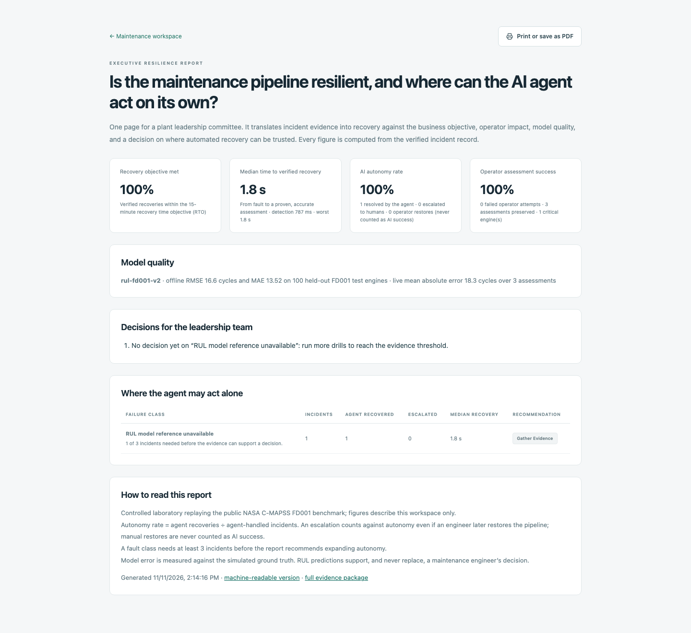
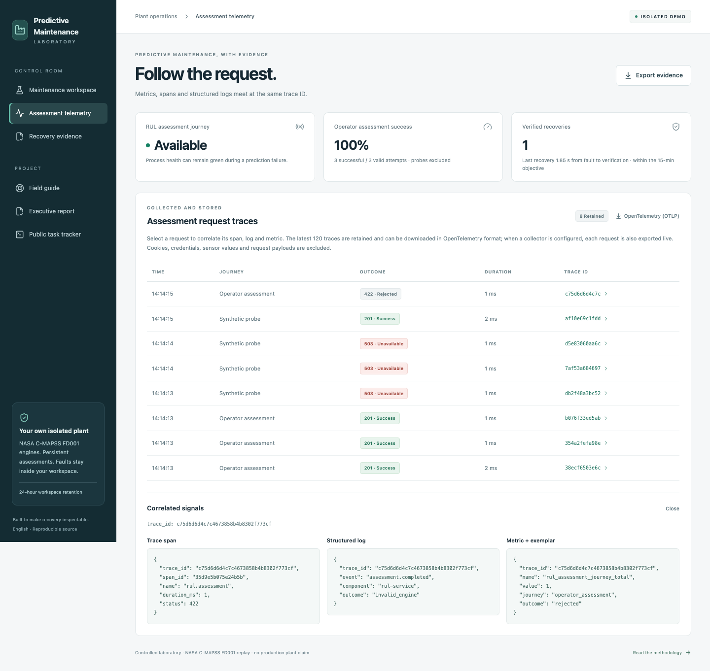
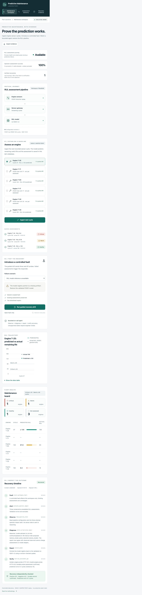
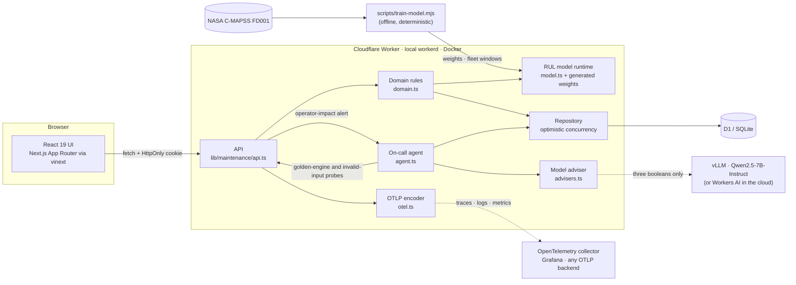
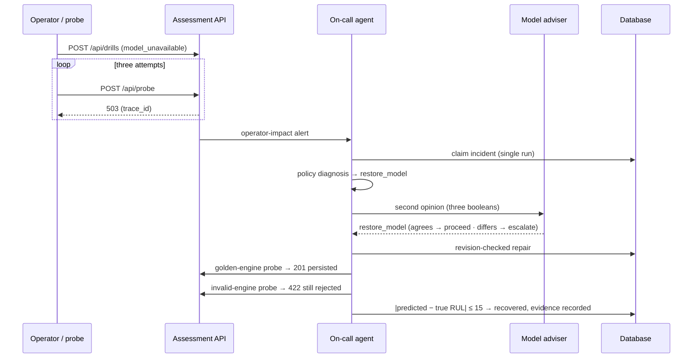
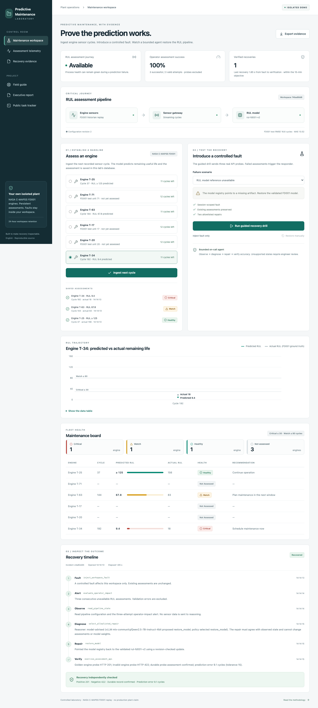

# Predictive Maintenance Lab

[](https://github.com/YessineZghal/Manufacturing_app/actions/workflows/ci.yml)
[](LICENSE)


**Checks that the RUL prediction works, not only that the server is up.**

**Live demo (development):** <https://predictive-maintenance-lab-dev.yessine-zghal.workers.dev>. Each visitor gets an isolated 24-hour workspace.

A common failure in predictive maintenance: **the dashboards are green, but planners get no remaining-useful-life prediction**, or a wrong one.

Three questions matter then: *can planners still get a correct prediction for every engine, who fixed the pipeline, and is the restored model still accurate?*

Predictive Maintenance Lab answers them in one application, built on the public **NASA C-MAPSS FD001** turbofan degradation benchmark:

- It predicts the **remaining useful life (RUL)** of turbofan engines from their sensor history and turns it into a maintenance decision.
- It alerts on **operator impact**: planners failing to get assessments, not a CPU graph.
- It lets an **AI agent repair the pipeline within limits a plant manager approves in advance**.
- It refuses to call anything "recovered" until a **golden reference engine is scored again, persisted, and predicted within tolerance of its true RUL**, and it keeps the evidence.


The architecture, components and delivery model are adapted from [Service Recovery Lab](https://github.com/cssaritama/Service-Recovery-Lab) (MIT). The business journey (reservations) is replaced by an RUL assessment journey on FD001, and verification adds a model-accuracy check.

---

## Executive summary

| Question a plant leadership team asks | What the system does |
|---|---|
| *Which engines need maintenance now?* | Each sensor cycle is scored by an RUL model trained on FD001. The maintenance board classifies every engine as **healthy**, **watch** (≤ 80 cycles: plan the next window) or **critical** (≤ 30 cycles: schedule now), next to its true RUL. |
| *How good is the model?* | Trained on the 100 FD001 run-to-failure engines and evaluated on the 100 held-out test engines: **RMSE 16.6 cycles, MAE 13.5, PHM08 score 417**. The build fails if RMSE regresses to 20 or more. |
| *Are planners affected right now?* | Measures the critical journey (an RUL assessment) directly. Pages only when assessments fail, not when infrastructure metrics move. A green health check does not hide an outage. |
| *Can we trust AI to act on the pipeline?* | The on-call agent has **bounded autonomy**: two allowlisted repairs, revision-checked writes and a language-model second opinion that can confirm but never widen its authority. When unsure, it hands over to an engineer. |
| *Did we actually recover?* | "Recovered" requires the golden engine to be scored **and** persisted **and** predicted within 15 cycles of its true RUL, **and** invalid input to still be rejected. A pipeline that answers HTTP 201 with a wrong prediction is escalated. |
| *Where should we let AI act on its own?* | The **executive report** turns the incident record into a decision for each failure class: expand autonomy, keep human review, keep it human-owned, or gather more evidence. It also reports offline and live model error. |
| *Can we show it to an auditor?* | Every incident yields a causal, trace-linked record (fault → alert → diagnosis → repair → verification), exportable as JSON and as OpenTelemetry. |
| *What does it cost to run?* | It runs on free tiers (Cloudflare Workers, D1, Workers AI) and on any laptop with one command. |

## The operating principles behind it

1. **Measure what the operator experiences.** The service-level indicator is *operator assessment success*. Process health is reported separately and deliberately stays green during failures, so the gap is visible.
2. **A prediction is only as good as its evidence.** The model is trained and evaluated reproducibly, its error is shown next to every prediction, and recovery checks accuracy, not just availability.
3. **Autonomy is bounded and based on evidence.** The agent may do exactly what has been approved, and nothing else. A model's opinion is advisory: if it disagrees with the observed state, the decision goes to a human.
4. **No claim without evidence.** A configuration change is not a recovery. Manual restores are recorded as engineer actions, never as AI successes.
5. **Humans own the maintenance decision.** RUL predictions support, and never replace, a maintenance engineer's judgement. Production promotion is a manual, approved step.

## Try it in five minutes

```bash
npm ci && npm run local            # Node.js 24+; open http://127.0.0.1:3000
npm run vllm:mac && npm run local:qwen   # optional, Apple silicon: Qwen2.5-7B adviser on vllm-metal
# or
docker compose up --build          # app + database, one command; open http://localhost:3000
```

1. **Assess an engine.** Select *Engine T-34* and click *Ingest next cycle* a few times. Each assessment persists, shows predicted vs actual RUL, and moves the engine from *watch* to *critical* on the maintenance board.
2. **Run the guided recovery drill** (*RUL model reference unavailable*). Three real assessments fail with HTTP 503, and the operator-impact alert fires.
3. **Watch the agent:** observe → diagnose (with a second opinion from Qwen2.5-7B on vLLM when configured) → revision-checked repair → verification through the live API, including a golden-engine accuracy check. About one second in the lab.
4. **Open *Assessment telemetry*.** One trace ID links the span, the structured log and the metric. Download the same data as OpenTelemetry.
5. **Try *Unrecognized plant dependency failure*.** The correct outcome is **escalation**. The agent does not guess.
6. **Export the evidence package.** Your assessments are still there, along with the model card.
7. **Open the executive report** (`/report`). The drills you ran become objective attainment, an AI autonomy rate, model quality and a decision per failure class.

| Executive report | Correlated telemetry | Mobile |
|---|---|---|
|  |  |  |

---

## The data and the model

| | |
|---|---|
| Dataset | NASA C-MAPSS **FD001**: one operating condition, one fault mode (HPC degradation). 100 training engines run to failure; 100 test engines truncated before failure, with published true RUL. Provenance and checksums: [dataset/README.md](dataset/README.md). |
| Features | For each cycle, the mean and least-squares slope of 14 informative sensors over a 30-cycle window, plus the cycle count (29 features) |
| Target | RUL capped at 125 cycles (the standard piecewise-linear target: early-life RUL is not observable) |
| Model | Ridge regression in closed form, trained by [`scripts/train-model.mjs`](scripts/train-model.mjs) and served as weights by a dependency-free TypeScript runtime ([`lib/maintenance/model.ts`](lib/maintenance/model.ts)) |
| Training | Full 30-cycle windows only, the same shape the model sees in service (17,731 examples) |
| Evaluation | Last cycle of each of the 100 test engines vs `RUL_FD001`: **RMSE 16.60**, MAE 13.52, PHM08 score 417.4; the correct maintenance band for 78 of 100 engines |
| Fleet | Six held-out test engines (T-25, T-71, T-63, T-17, T-20, T-34) replay their final 12 recorded cycles; every prediction is compared with the ground truth |
| Golden engine | Test unit 91 (true RUL 38, predicted 47.1). Synthetic probes score it; recovery requires an error ≤ 15 cycles |

The model is deliberately simple and explainable. Its main weakness is the **critical boundary**: of the 25 test engines with a true RUL of 30 cycles or less, 13 are predicted at 31–48 cycles and shown as *watch*, not *critical* (no healthy engine is flagged critical). Near failure its mean error is +4.5 cycles. The app shows the true RUL next to every prediction instead of hiding the error, and the [roadmap](docs/strategy.md) lists sequence models as the next step.

## Architecture



| Layer | Technology |
|---|---|
| Frontend | React 19, Next.js App Router on vinext (Vite), Tailwind CSS 4 |
| Backend | TypeScript on Cloudflare Workers (`workerd` locally and in Docker) |
| Machine learning | NASA C-MAPSS FD001; ridge regression trained offline in Node.js; inference in the Worker |
| Data | Cloudflare D1 (SQLite) with Drizzle migrations |
| AI | **vLLM serving Qwen2.5-7B-Instruct** (OpenAI-compatible API, structured JSON output) as an advisory reasoner; Cloudflare Workers AI as the cloud alternative. `compose.vllm.yaml` starts vLLM next to the app. |
| Observability | OpenTelemetry OTLP/JSON traces, logs and metrics; Grafana LGTM stack via Docker; Workers Logs |
| Quality | Node.js test runner, Playwright, ESLint, Prettier |
| Delivery | Docker Compose, GitHub Actions (CI → automatic dev → manual production → rollback) |

Design decisions and trade-offs: [docs/architecture.md](docs/architecture.md) · [ADRs](docs/decisions/README.md).

## How recovery works





Limits enforced in code:
- Only `restore_model` and `resume_gateway` exist.
- Repairs are compare-and-swap on the configuration revision.
- Each incident is claimed by a single run.
- Probes score the golden engine and never consume fleet cycles.
- The agent never edits assessments, never changes model weights, never relaxes validation and never executes generated code.

## Engineering quality

- **51 automated tests plus 7 browser journeys, one command** (`npm test`):
  - 5 model tests (the Worker runtime reproduces the recorded FD001 evaluation; RMSE quality gate; fleet windows match the raw files; golden engine within tolerance)
  - 10 domain unit tests
  - 12 model-adviser tests (including vLLM structured output, fallback, timeout and an end-to-end recovery advised by Qwen2.5-7B)
  - 4 OpenTelemetry tests
  - 5 executive-report tests
  - 15 integration tests on a real SQLite database, including *an inaccurate model fails verification even when every probe returns the expected status*
  - 7 Playwright browser journeys (desktop, mobile, maintenance board, executive report, every navigation link)

  `npm test` also fails if the committed model artifacts are stale (`npm run model:check`). See [docs/testing.md](docs/testing.md).
- **CI on every pull request:** formatting, lint, tests, then the full system in Docker with an end-to-end deployment check.
- **CD:** automatic deployment to development, a manual and approved production promotion, and rollback to a verified version.
- **Operations:** runbooks for the alert, the agent and rollback ([docs/operations.md](docs/operations.md)). Optional local Grafana with `docker compose -f compose.yaml -f compose.observability.yaml up --build`.

## Scope and limits

- This is a **controlled laboratory** replaying a public simulation benchmark. It does not connect to plant equipment, does not certify airworthiness and does not replace a maintenance engineer.
- The model is a linear baseline. Published deep-learning models report RMSE of roughly 11–18 on FD001; this one trades accuracy for transparency and zero-dependency inference.
- Recovery times and the [benchmark](evidence/performance.json) (48 assessments, 12 concurrent sessions, p95 ≈ 28 ms on a laptop) are lab observations, not SLOs.
- Not yet deployed publicly: the Cloudflare workflows are configured but have not run (see [docs/deployment.md](docs/deployment.md)).

## Repository layout

```
app/                   UI: maintenance workspace, /report (executive report), /guide, /tracker
lib/maintenance/       domain · model (RUL runtime) · *.generated.ts (weights, fleet) · agent · advisers · report · otel · api · repository
dataset/CMAPSS/        NASA C-MAPSS FD001 (train, test, true RUL) with provenance
db/, drizzle/          schema and SQL migrations
worker/                Cloudflare Worker entry point
tests/                 model, unit, adviser, OpenTelemetry, report, integration and browser tests
scripts/               model training, local runner, tests, deployment check, benchmark, demo capture, cloud config, tracker sync
.github/workflows/     CI, deploy-development, deploy-production (manual), rollback
docs/                  strategy, decisions (ADRs), spec, architecture, agent team, testing, operations, deployment, reviewer guide
evidence/              demo recording, evidence export, benchmark, console check
```

## Credits

- Data: NASA Ames Prognostics Center of Excellence. A. Saxena, K. Goebel, D. Simon and N. Eklund, "Damage Propagation Modeling for Aircraft Engine Run-to-Failure Simulation", PHM08, 2008.
- Architecture, components and delivery template: [Service Recovery Lab](https://github.com/cssaritama/Service-Recovery-Lab) by Carlos Saritama (MIT).

## License

[MIT](LICENSE)
