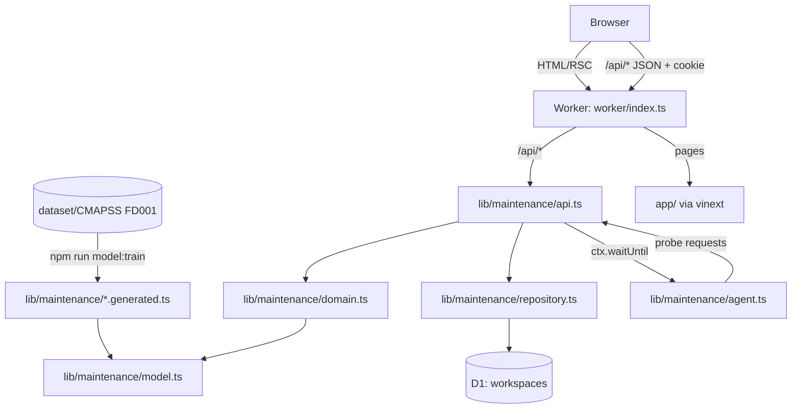

# Architecture

## System context

Predictive Maintenance Lab is one deployable unit: a Cloudflare Worker that serves both the React UI and a JSON API, backed by a D1 (SQLite) database. The RUL model is trained offline and ships inside the Worker as generated TypeScript. The same Worker runs in three places with no code changes:

| Environment | Runtime | Database |
|---|---|---|
| Local (`npm run local`) | `workerd` through Wrangler | Local D1 under `.wrangler/state` |
| Docker (`docker compose up`) | `workerd` inside `node:24-bookworm-slim` | Local D1 on the `maintenance-data` volume |
| Cloud (`development`, `production`) | Cloudflare Workers | Remote D1 database per environment |



## Components

### Training — `scripts/train-model.mjs`
A deterministic, dependency-free Node script:
- reads `train_FD001`, `test_FD001` and `RUL_FD001`;
- builds features per cycle from full windows only (the shape the Worker sees): 30-cycle window mean and least-squares slope for 14 sensors, plus the cycle count;
- fits closed-form ridge regression (λ = 1) on standardised features against RUL capped at 125;
- evaluates on the last cycle of each test engine (RMSE, MAE, PHM08 score);
- writes `model.generated.ts` (weights, scaler, evaluation) and `fleet.generated.ts` (replay windows for six fleet engines and the golden reference engine).

`--check` fails when the committed artifacts differ from what the script produces; `npm test` runs it first.

### RUL model runtime — `lib/maintenance/model.ts`
The same feature extraction and linear prediction in TypeScript, clamped to `[0, 125]` and rounded to 0.1 cycle, plus health bands (critical ≤ 30, watch ≤ 80) and recommendations. `tests/model.test.mjs` proves it reproduces the recorded evaluation.

### UI — `app/`
- `app/page.tsx`: the maintenance workspace, a client component with three views:
  - *Maintenance workspace*: pipeline map, engine selection and ingestion, saved assessments, drill, **maintenance board**, timeline;
  - *Assessment telemetry*: trace table and correlated signal detail;
  - *Recovery evidence*: verification summary, model card and incident history.

  It polls `/api/workspace` once per second only while an incident is active.
- `app/report/page.tsx`: the executive resilience report, including model quality.
- `app/guide/page.tsx`: field guide, data and model, methodology.
- `app/tracker/page.tsx`: the public task tracker, rendered from `public/tracker.json`.
- Accessibility: skip link, semantic landmarks, labelled controls, keyboard operation, responsive down to 360 px.

### API — `lib/maintenance/api.ts`
A framework-free `Request → Response` handler, so it can be tested without a server.

| Method and path | Purpose |
|---|---|
| `GET /api/health` | Process health only. It deliberately stays green during journey failures. |
| `POST /api/session` | Creates an isolated workspace and sets an `HttpOnly; SameSite=Strict` cookie (`pml_session`) |
| `GET /api/workspace` | Snapshot: engines with remaining cycles and latest assessment, assessments, incident, traces, metrics, model card |
| `GET /api/evidence` | The same snapshot as a downloadable, sanitised evidence package |
| `GET /api/report` | Executive resilience report |
| `GET /api/telemetry/otlp` | Retained telemetry as OpenTelemetry OTLP/JSON |
| `POST /api/assessments` | Operator ingests the next cycle of `{ engineId }`. Requires an `Idempotency-Key` header. |
| `POST /api/probe` | Synthetic probe assessment of the golden reference engine |
| `POST /api/drills` | Starts a controlled fault: `model_unavailable`, `gateway_paused` or `unknown_dependency` |
| `POST /api/restore` | Engineer manual restore, recorded as *cancelled*, never as an agent recovery |

Hardening: JSON-only bodies of at most 4 KB; cross-origin `POST` rejected using `Origin` and `Sec-Fetch-Site`; `no-store` caching and `nosniff`; a trace ID on every response, including errors.

### Domain — `lib/maintenance/domain.ts`
Pure functions over a `State` document:
- `assess` handles validation, idempotency, fault gating, the replay cursor (no over-ingestion), RUL inference and persistence;
- `recordAttempt` records telemetry and holds the alert rule;
- `startDrill` and `manualRestore` change configuration;
- `fleet` computes remaining cycles and the latest assessment per engine.

The model registry (`MODELS`) maps model IDs to artifacts; the configuration may only reference a registered model. Whenever the repository loads a workspace, `upgrade()` moves a model ID this release does not serve (after an upgrade or a rollback) to its known-good model; only the drill's deliberately missing reference (`MISSING_MODEL`) is left for the agent to repair.

### On-call agent — `lib/maintenance/agent.ts`
Four phases: **observe → diagnose → repair → verify**. Verification reads the persisted golden-engine assessment and requires an absolute error ≤ 15 cycles. See [operations.md](operations.md).

### Model adviser — `lib/maintenance/advisers.ts`
Optional second opinion from a language model: **Qwen2.5-7B-Instruct served by vLLM** (OpenAI-compatible API with structured JSON output) when `VLLM_URL` is set, otherwise Workers AI in the cloud. It receives three booleans, and its answer is parsed into one allowlisted action. Disagreement, malformed output or timeout → escalation.

### Executive report — `lib/maintenance/report.ts`
A pure function from the incident record to leadership measures: objective attainment against a 15-minute RTO, detection and recovery times, AI autonomy rate, operator impact (including critical engines), model quality (offline RMSE/MAE and live MAE) and a recommendation per failure class.

### OpenTelemetry encoder — `lib/maintenance/otel.ts`
Encodes journey signals as OTLP/JSON traces, logs and metrics (`rul_assessment_journey_total`). It serves `/api/telemetry/otlp` and pushes live to a collector when `OTEL_EXPORTER_OTLP_ENDPOINT` is set.

### Repository — `lib/maintenance/repository.ts`
- Each workspace is one row holding a JSON document plus a `revision` counter.
- `mutate()` uses **optimistic concurrency** (`UPDATE … WHERE revision = ?`, up to 24 retries). This is what makes concurrent ingestion safe and lets a single agent run claim an incident.
- Session tokens are random 256-bit values; only their SHA-256 hash is stored.
- Growth limits: 24-hour expiry, at most 1,000 workspaces and 240 KB per document.

## Data model

```sql
CREATE TABLE workspaces (
  id          TEXT PRIMARY KEY,
  token_hash  TEXT NOT NULL UNIQUE,   -- SHA-256 of the session cookie
  document    TEXT NOT NULL,          -- JSON State (see below)
  revision    INTEGER NOT NULL DEFAULT 0,
  created_at  INTEGER NOT NULL,
  expires_at  INTEGER NOT NULL
);
CREATE INDEX workspaces_expiry ON workspaces (expires_at);
```

The `State` document contains:
- `config`: model reference, gateway state, unknown-fault flag and configuration revision;
- `engines` (fleet metadata) and `assessments`; probe assessments are flagged;
- the current `incident` and its timeline `steps`, plus a bounded `history`;
- `traces` (the last 120) and aggregate `metrics`.

Sensor windows are not stored per workspace; they live in the generated fleet artifact, and each assessment stores only cycle, predicted RUL, true RUL and health.

## Key design decisions

| Decision | Alternatives considered | Rationale |
|---|---|---|
| Alert on consecutive **5xx assessment failures**, excluding 4xx | CPU/latency thresholds; any error | Measures operator impact. Invalid input is the user's error, not an outage. |
| **Verification includes prediction accuracy** on a golden engine | Status codes only | A pipeline that answers 201 with a wrong model is not recovered. |
| **Linear model trained offline, weights in the Worker** | Deep model; inference service; ONNX runtime | Explainable, deterministic, zero runtime dependencies and no extra service to fail. See [ADR 0006](decisions/0006-explainable-rul-model-trained-offline.md). |
| **Deterministic policy decides; an LLM gives a second opinion** | LLM decides and acts | Reproducible and safe; disagreement routes to a human. |
| **OpenTelemetry OTLP/JSON** encoded by hand | OpenTelemetry JS SDK | The SDK's Node exporters do not run on Workers. |
| **Per-visitor workspace** isolation | Shared global demo state | Visitors can break things safely without affecting anyone else. |
| Document-per-workspace with **revision CAS** | Normalised tables with row locks | D1 has no long-lived cross-request transactions. |
| **Cloudflare Workers + D1** | Container on a VM, Postgres | Free tier, identical local runtime, one artifact everywhere. |
| Probe engine separate from the fleet | Probes ingest real fleet cycles | Monitoring must never consume or distort the resource it measures. |
